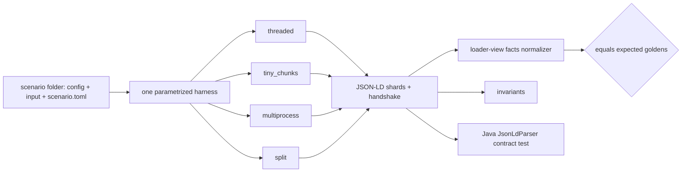

# Preprocessor Testing: Audit & Long-Term Data-Integrity Strategy

**Status:** v2, includes the second review round (2026-10-15)
**Audited:** `upstream/master` @ `6308a3e1`, plus PR #792 (`dcpbridge-perf`) where noted
**Links:** master links are GitHub permalinks to `6308a3e1`. PR links are relative paths on this branch.

Every claim below was measured or reproduced. The scripts are listed in
[Appendix B](#appendix-b--evidence--reproduction).

---

## TL;DR

- **The suite looks healthy but tests the wrong things.** It has 124 tests, 78% branch coverage and
  runs in 3.5 s. But the production (multiprocessing) path has **0% coverage**. The end-to-end
  goldens mostly re-test config discovery on the same 3 CSV files.
- **10 data-integrity issues were reproduced (E1–E8, E10, E11). No test catches any of them.**
  - 7 are on master: 6 edge cases (E1–E6) and a shard-splitting bug found by the new suite (E11).
  - 1 only happens in production on master (E7).
  - 2 were introduced by PR #792 (E8, E10).
  - E9 was **retracted** in v3: the pipeline does strip `dcs:`/`schema:` from references.
- **The strategy:**
  - A declarative scenario corpus: one folder per feature, no per-scenario code.
  - Goldens written as **loader-view facts**, i.e. what the loader actually stores.
  - A matrix of execution modes that must all produce the same golden.
  - Invariants checked on every run, and a feature registry that keeps coverage complete.
  - Contract tests at every boundary: Java loader, handshake, DC API, storage.
  - A **real-data diff before each release**, and a **seeded-bug check** that proves the suite
    catches what it should.
- **Branching:** test-only work built off master **rebases onto PR #792 with zero conflicts**. This
  was verified by simulation. Production changes conflict in one file, so they wait until after #792.
- **Fast path for #792:** the harness, 3 targeted scenarios, the split mode, fixes for E8 and E10,
  and a real-data diff. This avoids waiting for the full rollout.

> [!CAUTION]
> Must-fix items for PR #792, whatever is decided about the strategy:
> - **E8 (introduced by the PR):** the split path duplicates or garbles rows when quoted CSV fields
>   contain newlines.
> - **E10 (introduced by the PR):** the split path silently drops the end of a file when
>   `File.size()` under-reports.
> - **E7 (already on master, in code the PR rewrites):** production drops `dcid:provenanceUrl` from
>   every observation. The loader uses that field in its time-series key.

---

## Part 1 — Audit

### 1.1 What exists today

| Layer | Files | Tests | What they assert |
|---|---|---|---|
| Unit | config, data, nodes, validation, util, file_match, filesystem | 74 | Helper behavior, mostly config parsing |
| JSON-LD writer | `jsonld_stream_writer_test.py` | 18 | Shard shape, a few value cases, fast-vs-rdflib parity |
| Importer goldens | VPR, entities, events, MCF | 13 | `RecordingGraphWriter` output compared to a CSV golden |
| Runner E2E goldens | `runner_test.py` | 9 golden + 10 other | JSON-LD output, compared order-insensitively |

### 1.2 Measured coverage (`coverage run --branch`, master)

| Module | Cover | Notable uncovered code |
|---|---|---|
| `stats/runner.py` | **65%** | [L143–179](https://github.com/datacommonsorg/import/blob/6308a3e1894f2ab2b398531767aff8e9b5d9aed0/simple/stats/runner.py#L143-L179) (worker function) and [L691–760](https://github.com/datacommonsorg/import/blob/6308a3e1894f2ab2b398531767aff8e9b5d9aed0/simple/stats/runner.py#L691-L760) (process pool and result merge). **This is the production path.** |
| `stats/variable_per_row_importer.py` | 82% | [L72–74](https://github.com/datacommonsorg/import/blob/6308a3e1894f2ab2b398531767aff8e9b5d9aed0/simple/stats/variable_per_row_importer.py#L72-L74): per-row `unit` / `scalingFactor` / `measurementMethod` / `observationPeriod` columns are never exercised |
| `stats/jsonld_stream_writer.py` | 89% | Collision summary, malformed-props paths |
| `util/dc_client.py` | 35% | Entity resolution and retries (mocked out everywhere) |
| **Total** (`stats` + `util`) | **78%** | |

### 1.3 What works well (keep it)

- The golden pattern already has an update mode (`TEST_MODE=write`, `./run_test.sh -g`).
- Runner comparisons ignore shard names and ordering.
- The `RecordingGraphWriter` seam allows importer-level tests.
- Time is frozen with `freeze_time`, and `DC_API_KEY` is cleared to catch stray API calls.
- [`test_node_fast_vs_rdflib_parity`](https://github.com/datacommonsorg/import/blob/6308a3e1894f2ab2b398531767aff8e9b5d9aed0/simple/tests/stats/jsonld_stream_writer_test.py#L249-L322)
  is an early form of **differential testing** (running two implementations on the same input and
  comparing). This strategy generalizes it.

### 1.4 Gaps, ranked by data-integrity risk

1. **The tested path is not the production path.**
   - Every runner golden forces `use_multiprocessing=False`
     ([TODO](https://github.com/datacommonsorg/import/blob/6308a3e1894f2ab2b398531767aff8e9b5d9aed0/simple/tests/stats/runner_test.py#L72-L78)).
     Production uses `True`.
   - The code itself admits the two branches behave differently
     ([runner.py L670–677](https://github.com/datacommonsorg/import/blob/6308a3e1894f2ab2b398531767aff8e9b5d9aed0/simple/stats/runner.py#L670-L677)).
   - PR #792 adds one multiprocess E2E test, but it only checks counts and statuses. It passes
     despite E7 and E8.
2. **The end-to-end scenarios vary config plumbing, not data semantics.**
   - 5 of the 9 runner goldens share **byte-identical** `countries.csv`, `wikidataids.csv` and
     `variable_per_row.csv`.
   - These features appear in **no** scenario config: per-row `unit` / `scalingFactor` /
     `measurementMethod` / `observationPeriod`, `ignoreColumns`, `customIdNamespace`,
     `importProxyEntities`.
3. **Chunk boundaries are never crossed.** Fixtures have 2–10 rows, but the chunk sizes are 10,000
   (writer), 10,000 (reader) and 50,000 (PR). Only one unit test shrinks `_CHUNK_SIZE`.
4. **Goldens don't show what the loader stores.**
   - Compacted JSON-LD hides loader behavior. E9 has been in the events golden unnoticed.
   - The goldens are also split across uuid-named shard files. Running `-g` rewrites whole
     directories, which invites rubber-stamping.
5. **The most production-like tests have weak assertions.**
   - `test_dcp_bridge*` checks that "≥1 shard exists".
   - It asserts `provenanceUrl` only in serial mode
     ([L315–317](https://github.com/datacommonsorg/import/blob/6308a3e1894f2ab2b398531767aff8e9b5d9aed0/simple/tests/stats/runner_test.py#L315-L317)),
     and that is exactly the field production drops.
6. **Some tests exercise inputs production never sees.** `test_observation_parsing_edge_cases`
   expects `"Unavailable"` to be emitted. In the real pipeline, `validate_numeric_values` rejects it
   first.
7. **The storage layer is never tested as in production.** Everything runs on local disk. GCS
   behaviors (listed size vs. readable bytes, ranged reads, retries) are untested. E10 is a direct
   consequence.
8. **No invariants, no accounting, no performance tests.**
   - Nothing checks for unique observation IDs, nulls or required properties.
   - The reporter doesn't count rows read, dropped or emitted.
   - There are no speed or memory regression tests, even though recent work is perf work.
9. **Hygiene problems.**
   - Mocks are assigned at module level and never restored: 5 sites on master
     (e.g. [runner_test L66–70](https://github.com/datacommonsorg/import/blob/6308a3e1894f2ab2b398531767aff8e9b5d9aed0/simple/tests/stats/runner_test.py#L66-L70)),
     plus the PR's new test.
   - A harness branches on scenario names
     ([VPR test L87–98](https://github.com/datacommonsorg/import/blob/6308a3e1894f2ab2b398531767aff8e9b5d9aed0/simple/tests/stats/variable_per_row_importer_test.py#L87-L98)).
   - **46 fixture files are orphaned**: `cache/`, `db/`, `nl/` and `stat_var_hierarchy_generator/`
     are referenced by no test.
   - About 300 lines of fixtures are written as Python string literals.
   - Module-level caches persist between tests run in the same process: `_KNOWN_CUSTOM_PREFIXES`,
     plus `_rewrite_cache` and `_uri_ref_cache` added by the PR.
   - The "serial" mode is actually **multithreaded** (up to 32 threads).

### 1.5 Evidence: issues the current suite misses

Every run below **succeeds** (exit 0). The impact column was checked against the loader code
(`JsonLdParser`, `GraphReader`).

| # | Where | Input | Preprocessor output | Downstream impact | Severity |
|---|---|---|---|---|---|
| E1 | master | values `1e5`, `inf` | JSON strings `"1e5"` / `"inf"`, which still pass numeric validation | The loader stores all values as text, so this is mostly inconsistent formatting. `inf` may break numeric consumers. | Low |
| E2 | master | entity `NA` (Namibia's ISO code) | Observation with **no `observationAbout`** | The ingestion pipeline [throws `missing observationAbout`](https://github.com/datacommonsorg/import/blob/6308a3e1894f2ab2b398531767aff8e9b5d9aed0/pipeline/util/src/main/java/org/datacommons/ingestion/util/GraphReader.java#L313-L317), so the **whole downstream job fails**, far from the cause | High |
| E3 | master | variable `None` | `"dcid:variableMeasured": null` | An observation with no variable reaches the loader (exact failure mode not verified) | High |
| E4 | master | same key, values 1 and 2 | Both emitted with the **same `@id`**; only a log warning | Within a file the loader keeps whichever it parses last; across files the result depends on order | Med |
| E5 | master | `country/USA␠` and `country/USA` | Same entity/variable/date, **different `@id`s, 0 collisions** | Duplicate data points bypass deduplication; IDs are unstable | Med |
| E6 | master | quoted variable containing `\n` | DCID `dcid:Count_\nA` emitted | An invalid DCID is ingested | Med |
| E7 | master + PR | MCF provenance with a `url` (the standard DCP setup) | Production (multiprocess) run: **`provenanceUrl` missing on every observation** (26 facts vs. 29 in serial) | `provenanceUrl` is [read into the time-series key](https://github.com/datacommonsorg/import/blob/6308a3e1894f2ab2b398531767aff8e9b5d9aed0/pipeline/util/src/main/java/org/datacommons/ingestion/util/GraphReader.java#L382-L395) ([equality](https://github.com/datacommonsorg/import/blob/6308a3e1894f2ab2b398531767aff8e9b5d9aed0/pipeline/data/src/main/java/org/datacommons/ingestion/data/TimeSeries.java#L143)), so **source attribution is lost in prod** | High |
| E8 | PR | ignored multi-line `notes` column in a split file | **44 observations from 40 rows**; parameter sweeps lost up to 13 rows and garbled up to 16 | Duplicate and garbled data | High |
| ~~E9~~ | — | **Retracted (v3).** Claimed that `dcs:`/`schema:` references in the events golden are stored with the prefix still on | Wrong: after `JsonLdParser`, `GraphReader` strips `dcid:`/`dcs:`/`schema:` from ids, types and references via [`McfUtil.stripNamespace`](util/src/main/java/org/datacommons/util/McfUtil.java#L164-L171). The scenario harness now models both layers. | — |
| E11 | master (found by the new suite) | More than `_CHUNK_SIZE` (10,000) global node triples in a folder | [`commit_and_close`](simple/stats/jsonld_stream_writer.py#L536-L546) slices global triples without keeping a subject's triples together, unlike [`_write_triples_to_disk`](simple/stats/jsonld_stream_writer.py#L487-L508) | A node lands in two shards. The loader builds a record with no `typeOf` for one of them and [types it `Thing`](pipeline/util/src/main/java/org/datacommons/ingestion/util/GraphReader.java#L57-L62) | Med |
| E10 | PR | `File.size()` reports fewer bytes than the file has | Split path stops at the reported size: **4/40 rows lost at 90%, 16/40 at 60%** | Silent loss of the file's tail. Possible with stale listings, or GCS objects stored gzip-compressed (the reported size is the compressed size). | Med |

**Root causes of the PR #792 issues:**
- **E8** ([`_iter_observation_chunks`](simple/stats/variable_per_row_importer.py#L414-L434)):
  1. Batches are cut on *physical* lines. When a batch ends inside a quoted field, pandas raises
     `EOF inside string`.
  2. A broad `except` then falls back to round-robin reading **after rows were already yielded**.
     Those rows are emitted again, and the parts stop forming an exact partition.
  3. Production uses 50,000-line batches and splits files over 8 MB
     ([`_SPLIT_TARGET_BYTES`](simple/stats/runner.py#L66-L67)), so any large file with quoted
     newlines is exposed.
- **E10** ([`_iter_chunks_byte_range`](simple/stats/variable_per_row_importer.py#L357-L400)): the
  last part stops at `end_byte = file_size`, where `file_size` comes from
  [`File.size()`](simple/util/filesystem.py#L372-L376), often a cached listing value. The fix is
  one line: the last part should read to EOF.

> [!NOTE]
> My first differential run for E8 **passed by coincidence**. The fixture had 4 physical lines per
> 3 records, and a batch size of 4 lined up exactly with record boundaries. Sweeping the parameters
> exposed the bug. Lesson: boundary tests must **sweep** sizes, not pick a single value.

Some of E1–E6 and E9 may be intended behavior. The point is that nothing **pins** them, so neither
a fix nor a regression would be noticed. Each becomes a scenario with a decided expected output.

---

## Part 2 — Long-term strategy

### 2.1 Principles

1. **Test what the loader ingests** (loader-view facts), not implementation details such as shards,
   file names or key order.
2. **One feature per scenario.** Scenarios are *data*, not code.
3. **Every execution mode must produce identical facts.** Perf work cannot change goldens.
4. **Count everything and assert conservation.** Data that isn't counted can't be protected.
5. **Decide edge cases and pin them**, instead of discovering them in production.
6. **Prove the suite works.** It must fail on known bugs (seeded-bug check) and agree with real data
   (release diff).

### 2.2 Architecture



### 2.3 Test layers

| Layer | Scope | Format | When |
|---|---|---|---|
| **L1 Spec tables** | Value coercion, dates, observation identity, namespaces, NA tokens | `parametrize` tables (input → output) | Every PR, milliseconds |
| **L2 Importer** | CSV + config → rows/triples via `RecordingGraphWriter` | CSV golden (existing) | Every PR |
| **L3 Scenario corpus** | Input directory → JSON-LD → facts, in every mode | `facts.tsv`, `report.json`, `handshake.json` | Every PR, ~1–2 min |
| **L4 Generative / stress** | Seeded random CSVs (dialects, sizes), size sweeps, serial-vs-parallel diffs | Invariants + differential, no goldens | Nightly |
| **Contract** | Java `JsonLdParser` run on scenario outputs; recorded DC API responses | Parsed McfGraph must match the facts | PRs touching the writer or loader; DC API recordings refreshed periodically |
| **Perf / memory** | Fixed synthetic datasets | Rows/s, peak RSS, shard count vs. baselines | Nightly |
| **Release diff** | Real DCP datasets, baseline vs. candidate | Facts diff | Before each rollout |

### 2.4 Scenario corpus

Each scenario directory, e.g. `simple/tests/stats/scenarios/obs_unit_column/`, contains:

```text
scenario.toml            # description, features, DC API fixtures and faults, modes, expectations
input/config.json
input/data.csv
input/provenance.mcf
expected/facts.tsv       # loader-view facts (golden); expected/error.json for error scenarios
expected/report.json     # normalized: counts and statuses, no timestamps
expected/handshake.json  # success payload (importList, graph path globs) or failure payload
```

Example `scenario.toml`:

```toml
description = "Per-row unit column overrides config default; empty cell falls back."
features    = ["obs.vpr", "obs.unit.column", "obs.unit.default"]
modes       = "all"            # or ["threaded"] for error scenarios
expect      = "success"        # or "error"
expected_collisions = 0
# known_issue = "b/123: provenanceUrl dropped in multiprocess"
# xfail_modes = ["multiprocess"]

[dc_api.types]                 # served by a stdlib HTTP stub via DC_API_ROOT
"country/USA" = "Country"

[dc_api.faults]                # optional: exercise the #791 retry path
"/v2/node" = ["429", "500", "ok"]
```

- **Naming:** `<area>_<feature>[_<variant>]`, with areas `obs_ ent_ evt_ mcf_ cfg_ csv_ val_ id_
  err_ storage_ combo_`.
- **No new dependencies:** TOML is parsed by stdlib `tomllib` (Python 3.11).

### 2.5 The golden: loader-view facts

The normalizer mirrors what [`JsonLdParser`](https://github.com/datacommonsorg/import/blob/6308a3e1894f2ab2b398531767aff8e9b5d9aed0/util/src/main/java/org/datacommons/util/parser/jsonld/JsonLdParser.java)
stores:

1. **Expand** every shard with its own `@context` using `pyld` (already a dependency). A change to
   `@context` therefore shows up in the facts.
2. **Apply the loader's rules:**
   - Strip `https://datacommons.org/browser/` and `https://schema.org/`. Any other prefix stays and
     becomes visible, which is how E9 would show up.
   - Keep only the last path segment of each key.
   - Map `@type` to `typeOf`.
   - Move nested `observationProperties` onto the observation.
   - **Keep each literal's JSON type**, so `100`, `100.0` and `"100"` stay distinct.
3. **Prefix each fact with its import folder.** The handshake selects shards per import folder, so
   a shard written to the wrong folder is data loss.
4. **Treat facts as a set**, and **count observation records per `@id` separately.** Exact
   duplicates like E8's would otherwise collapse into a single fact.

```text
Provenance1	obs_2039…	typeOf	StatVarObservation
Provenance1	obs_2039…	observationAbout	country/USA
Provenance1	obs_2039…	provenanceUrl	"https://s.org/p"
Provenance1	obs_2039…	value	"1e5"
```

The golden diff in a PR then reads as "these facts changed". For example, E7 appears as removed
`provenanceUrl` lines and E1 as a quoted `"1e5"`.

**Why not RDF canonical N-Quads?** The loader departs from RDF in two ways:
1. It moves `observationProperties` from inside `variableMeasured` onto the observation
   ([L149–184](https://github.com/datacommonsorg/import/blob/6308a3e1894f2ab2b398531767aff8e9b5d9aed0/util/src/main/java/org/datacommons/util/parser/jsonld/JsonLdParser.java#L149-L184)).
   RDF would attach them to the StatVar node and merge them across observations, hiding swaps.
2. It stores literals via `toString()`, so the JSON type of a value matters.

**Keeping the emulation honest:** the Python normalizer re-implements Java rules. The cross-language
contract test (§2.10) catches drift between the two.

### 2.6 Execution-mode matrix

Every scenario runs in every mode and must match **the same** goldens.

| Mode | Setting | Catches | Measured cost |
|---|---|---|---|
| `threaded` | `use_multiprocessing=False` (the current test mode; up to 32 threads) | Baseline. Goldens are generated in this mode. | ~0.02 s / scenario |
| `tiny_chunks` | Writer shard size 1, reader chunk 2 | Shard and chunk boundary bugs | ~0.02 s / scenario |
| `multiprocess` | `use_multiprocessing=True` + DC API stub | Production path, result merging, ordering (**E7**) | ~0.8 s / scenario (macOS spawn; faster with fork on Linux CI) |
| `split` | Sweep part counts × read rows, run in-process; plus 1 multiprocess run | Byte-range partition bugs (**E8**, **E10**) | Fast in-process |
| Determinism | Same mode run twice | Nondeterministic output | — |
| `rdflib_nodes` (optional) | `FAST_NODE_EXPORT=false` | Fast-vs-rdflib parity; gives the certainty the existing TODO needs before deleting the rdflib path | ~0.02 s / scenario |

At ~50 scenarios the full matrix takes **about 1–2 minutes per PR**.

Small seams this needs:
- **Env-configurable size knobs** (writer `_CHUNK_SIZE`, reader chunk rows). Spawned workers
  re-import modules, so patching constants doesn't reach them. `SIMPLE_IMPORT_SPLIT_TARGET_BYTES`
  is already env-based.
- **DC API stub, no production change.** `dc_client.get_api_root()` reads `DC_API_ROOT` at call
  time, and child processes inherit env vars. This resolves the existing TODO.

### 2.7 Invariants (every scenario × mode, no golden needed)

- Every shard parses and JSON-LD-expands.
- Every observation has `@id`, `@type`, `variableMeasured`, `observationAbout`, `observationDate`
  and `value`, and contains no `null` values (catches E2, E3).
- Each observation `@id` appears in exactly one record unless `expected_collisions` says otherwise
  (catches E4, E8).
  - The harness computes this from the output files, because the writer can't see duplicates
    across processes.
- **Row conservation:** `rows_read == observations_emitted + Σ rows_dropped[reason]`. This needs
  small reporter counters.
- Every expanded IRI starts with a base the loader strips, or is a deliberate external URL
  (catches E9).
- DCIDs contain no whitespace or control characters (catches E5, E6, once the expected behavior is
  decided).
- The success handshake lists exactly the import folders that contain shards. Error scenarios
  produce a FAILURE handshake and no `importList`.

### 2.8 L1 spec tables (executable documentation)

```python
VALUE_SPEC = [  # raw cell -> emitted JSON-LD value (the decided contract)
    ("100", 100), ("100.0", 100.0), ("-0", 0), ("007", 7),
    ("1e5", 100000.0),   # today: "1e5" (stored as text either way; pick one canonical form) (E1)
    ("inf", REJECT),     # today: "inf" (E1)
]
```

Similar tables cover observation identity (including whitespace, E5), date coercion, namespace
rewriting and NA tokens (E2, E3).

### 2.9 Feature registry

`scenarios/features.toml` lists every config key, data-path behavior and CSV dialect. A meta-test
fails if a registered feature has no scenario, or if a scenario cites an unknown feature. Adding a
config option therefore forces a scenario. This keeps coverage granular while the test code stays
at three small files: harness, normalizer and DC stub.

### 2.10 Contracts at the boundaries

| Boundary | What to add | Catches |
|---|---|---|
| **Ingestion workflow** | `expected/handshake.json` for both success (`importList`, graph path globs, `generateStatVarGroups`) and failure payloads | Wrong import lists or globs, shards that are never ingested |
| **Java loader** | Check 2–3 scenario outputs into the Java test resources, parse them with the real `JsonLdParser`, and compare to the same facts | Drift between the Python emulation and the loader |
| **DC API** | Semantic fixtures, fault injection (429/500/timeouts), and periodically re-recorded real responses (or a nightly live smoke test with a key) | Retry bugs (#791), partial resolution, stubs drifting from the real API |
| **Storage** | A fake-storage seam: `File` objects whose `size()` disagrees with the readable bytes, ranged-read failures, transient errors | E10 and other GCS-only behaviors |

### 2.11 Proving the suite works

- **Seeded-bug check (acceptance test for this whole strategy).** Re-introduce the 3 bugs fixed
  during the #792 review, plus E8 and E10. The suite **must fail** for each one. This also answers
  "why didn't the tests catch this?". The 3 fixed bugs:
  - the exact-newline boundary row drop,
  - worker reports that were never merged,
  - missing status aggregation.
- **Real-data release diff.** Run baseline (master) vs. candidate (PR) on 2–3 real DCP datasets,
  such as the UN dataset from the 64-core Batch job. Diff the loader-view facts and the per-`@id`
  record counts. Every diff must be explained. This is the most direct way to trust #792 on real
  inputs.
- *Later, optional:* mutation testing to measure how well the suite detects injected bugs.

### 2.12 Performance and memory

- Nightly benchmarks on fixed synthetic datasets track rows/s, peak RSS and shard count, with an
  alert on regressions.
- A high-cardinality dataset checks memory usage of the bounded caches.

### 2.13 Golden and known-issue workflow

- `./run_test.sh -g` regenerates goldens **from `threaded` mode only**. The other modes only
  compare against them.
- Rule in the PR template: golden diffs must be explained, and perf-only PRs must have **zero**.
- Known bugs are recorded with `known_issue` plus `xfail_modes`, using `strict=True`. When a bug is
  fixed, the test unexpectedly passes and fails, which forces removing the marker. This lets the
  suite land green while documenting E1–E7 and E9.

### 2.14 Hygiene

- Replace module-level mock assignment with `mock.patch` fixtures. The PR's new tests need the same
  change after the rebase.
- Delete the 46 orphaned fixtures.
- Move inline string fixtures into scenario folders.
- Remove name-based branching from harnesses.
- Reset module-level caches between scenarios.
- Rename the `serial` mode to `threaded`.
- Add `python -m coverage` to `run_test.sh` (`coverage` is already installed), with a ratcheting
  floor for `stats/`.

---

## Part 3 — Branching off master and merge conflicts

**Method:**
1. Applied a realistic version of the planned work to master in a separate worktree, in two commits.
2. Replayed PR #792's commits on top **one at a time with `git rebase`**, as a real rebase would.
3. Cross-checked with a tree-level `git merge-tree`.

The `dcpbridge-perf` branch itself was never modified.

| Base | Result |
|---|---|
| master alone (baseline) | **Clean.** 11 commits replay as 9: the duplicate #791 commit has the same patch-id and is dropped, and the merge commit is dropped. |
| master + **test-only work** (Phases 0–1) | **Clean, 0 conflicts** |
| master + **production changes** (Phase 2) | **1 conflict** in `simple/stats/variable_per_row_importer.py`. It stops at `19cea6b9 Batch performance improvements`, where the env-configurable read-chunk setting collides with the PR's `_READ_CHUNK_ROWS`. |

The simulated test-only work touched:
- new harness files and a scenario folder,
- conversion of the 9 runner JSON-LD goldens to `facts.tsv`,
- deletion of the 46 orphaned fixtures,
- edits to the imports and middle of `runner_test.py` (harness body, mock hygiene),
- mock hygiene and removal of name branching in `variable_per_row_importer_test.py`,
- a coverage step in `run_test.sh`.

**Rules to stay conflict-free:**
1. Do the test-only work off master now. Do the production changes (env knobs, reporter counters)
   **on top of #792 or after it merges**.
2. Put new code in **new files**. Don't append to the end of `runner_test.py` or
   `variable_per_row_importer_test.py`; the PR appends there.
3. Leave `test_data/variable_per_row_importer/` in place. The PR's
   `test_split_import_matches_unsplit` reads from it.
4. After the rebase, apply mock hygiene to the PR's new tests, which still use the leaky pattern.
5. Golden diffs that appear after the rebase are not conflicts. They are the suite doing its job:
   each one is either a bug or an intended change.

**Website mirror:** `website/import` tracks `dcpbridge-perf`. Master-based test work should **not**
be mirrored there until it merges. (Open question below.)

---

## Part 4 — Rollout plan

### Track A — Fast gate for PR #792 (days)

| Step | Lands on | Content |
|---|---|---|
| A1 | master | Phase 0: harness, loader-view normalizer, DC stub, the 9 runner goldens ported, hygiene. Test-only, conflict-free. |
| A2 | master | 3 targeted scenarios: `csv_multiline_quoted` (E8), `obs_provenance_url_from_mcf` (E7), `storage_size_mismatch` (E10) |
| A3 | PR #792 | Rebase onto A1–A2, add `split` mode, **fix E8 and E10**, decide on E7 |
| A4 | — | Real-data release diff (master vs. PR) and seeded-bug check |

**Merge criteria for #792:**
- zero golden diffs in all modes,
- a clean real-data diff, or every diff explained,
- the seeded-bug check fails as expected.

### Track B — Long-term (in parallel)

| Phase | Lands on | Content | Exit criterion |
|---|---|---|---|
| 1 | master | ~50 scenarios (Appendix A); E1–E6 and E9 recorded as known issues | Feature registry complete |
| 2 | after #792 | Production seams (env knobs, reporter counters); `tiny_chunks` + `multiprocess` modes for every scenario; conservation invariant | E7 visible (or fixed) |
| 3 | master | Contracts: Java parser test, handshake goldens, DC fault injection, storage seam | Boundaries covered |
| 4 | ongoing | Nightly L4 generative runs, perf/memory benchmarks, coverage ratchet | — |

---

## Decisions needed

1. **Golden format:** loader-view facts (recommended) or keep the JSON-LD goldens?
2. **E1–E6 and E9:** for each, fix now or record today's behavior as a known issue?
3. **E7:** fix inside #792 (which rewrites the multiprocess path) or in a separate PR?
4. **E8 and E10:** fix in #792. Recommended as required for merging.
5. **Production seams after #792:** env-configurable size knobs and reporter row counters. OK?
6. **L4 generator:** stdlib seeded `random` (no new dependencies, recommended) or `hypothesis`
   (a new dependency that would need vetting)?
7. **Website mirror:** skip mirroring master-based test work (recommended)?
8. **Real-data diff:** which 2–3 DCP datasets should be used?

---

## Appendix A — Initial scenario list (~50)

| Area | Scenarios |
|---|---|
| Observations | `obs_basic`, `obs_unit_column`, `obs_scaling_factor_column`, `obs_measurement_method_column`, `obs_observation_period_column`, `obs_static_observation_properties`, `obs_property_default_fallback`, `obs_custom_dimensions_{1,2,3}`, `obs_columns_to_resolve`, `obs_ignore_columns`, `obs_proxy_entities_{on,off}`, `obs_custom_id_namespace`, `obs_provenance_url_from_mcf` (E7), `obs_multi_file_same_provenance` |
| Entities / events / MCF | `ent_id_column`, `ent_no_id_column`, `ent_entity_columns`, `evt_basic`, `evt_id_columns`, `evt_statvar_references` (E9), `mcf_basic`, `mcf_custom_prefixes`, `mcf_multivalued` |
| Config / discovery | `cfg_wildcards`, `cfg_subdirs_{included,excluded}`, `cfg_data_download_url`, `cfg_multi_import_all`, `cfg_archives_ignored`, `cfg_unmatched_files_ignored`, `cfg_handshake_multi_import` |
| CSV dialect | `csv_crlf`, `csv_utf8_bom`, `csv_quoted_commas`, `csv_multiline_quoted` (E8), `csv_blank_lines`, `csv_no_trailing_newline`, `csv_unicode`, `csv_header_only`, `csv_invalid_encoding` |
| Values / identity | `val_numeric_formats` (E1), `val_na_tokens`, `id_na_tokens_in_ids` (E2, E3), `id_duplicate_keys` (E4), `id_whitespace` (E5), `id_invalid_chars` (E6) |
| Storage / DC API | `storage_size_mismatch` (E10), `dc_api_transient_errors` (#791 retries) |
| Errors | `err_unmapped_columns`, `err_missing_columns`, `err_too_many_dimensions`, `err_unresolved_entities`, `err_invalid_mcf`, `err_non_numeric_value` |
| Combo | `combo_dcp_bridge` (port of `input_dir_driven` with strict provenance) |

## Appendix B — Evidence & reproduction

Local scripts (from the investigation workspace):

| Script | Reproduces |
|---|---|
| [probe_edge_cases.py](file:///Users/gmechali/.gemini/jetski/brain/4798c402-5102-47d9-ada0-092b27492cc3/scratch/probe_edge_cases.py) | E1–E6 on master |
| [probe_mode_differential.py](file:///Users/gmechali/.gemini/jetski/brain/4798c402-5102-47d9-ada0-092b27492cc3/scratch/probe_mode_differential.py) | E7 (serial vs. multiprocess); also a prototype of the facts normalizer |
| [probe_split_differential.py](file:///Users/gmechali/.gemini/jetski/brain/4798c402-5102-47d9-ada0-092b27492cc3/scratch/probe_split_differential.py) | E8 (split vs. unsplit, with a parameter sweep); E10 via a patched `File.size()` |
| [time_modes.py](file:///Users/gmechali/.gemini/jetski/brain/4798c402-5102-47d9-ada0-092b27492cc3/scratch/time_modes.py) | Per-scenario cost of each mode |
| [simulate_test_work.py](file:///Users/gmechali/.gemini/jetski/brain/4798c402-5102-47d9-ada0-092b27492cc3/scratch/simulate_test_work.py) | The Part 3 change sets (`phase01`, `phase2`) used for the rebase simulation |

- Run the probes from a checkout's `simple/` directory with `PYTHONPATH=. python <probe>`.
  - Use `scratch/import_master` for master.
  - Use this repo for the PR.
- The master worktree can be removed with
  `git worktree remove /Users/gmechali/.gemini/jetski/brain/4798c402-5102-47d9-ada0-092b27492cc3/scratch/import_master`.

## Appendix C — Changelog

- **v1 (2026-10-14):** initial audit, E1–E8, scenario corpus, facts goldens, mode matrix, rollout.
- **v2 (2026-10-15):** second review round.
  - **Severity changes:** E2 raised (downstream job failure), E1 lowered (stored as text either
    way). E7's impact confirmed in the loader.
  - **New issues:** E9 (prefixed refs in an existing golden) and E10 (split-path tail loss).
  - **Golden format:** goldens switched to loader-view facts that include the import folder.
  - **Strategy additions:**
    - boundary contracts: handshake, Java parser, DC API faults and drift, storage seam,
    - the seeded-bug check and the real-data release diff,
    - perf and memory benchmarks,
    - measured CI cost,
    - the optional `rdflib_nodes` mode,
    - mode renamed from serial to threaded,
    - cache-isolation hygiene.
  - **Planning:** added the merge-conflict analysis (Part 3), the Track A fast path for #792, and
    the updated decisions.
